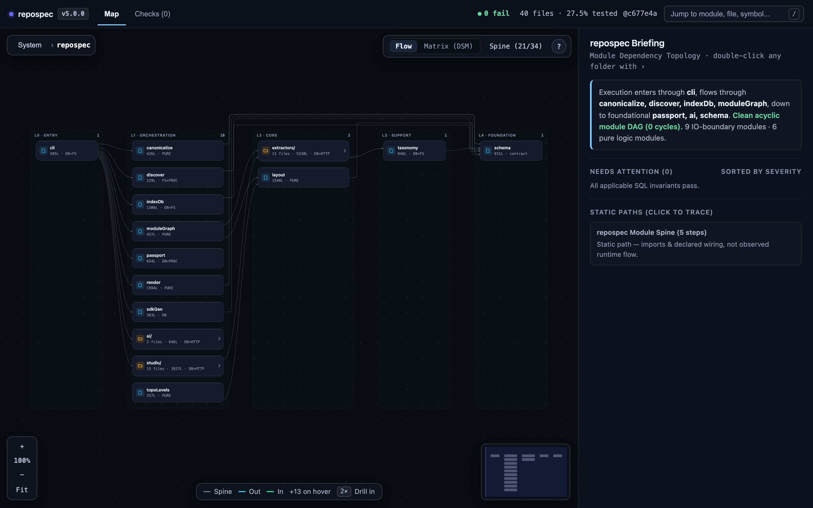
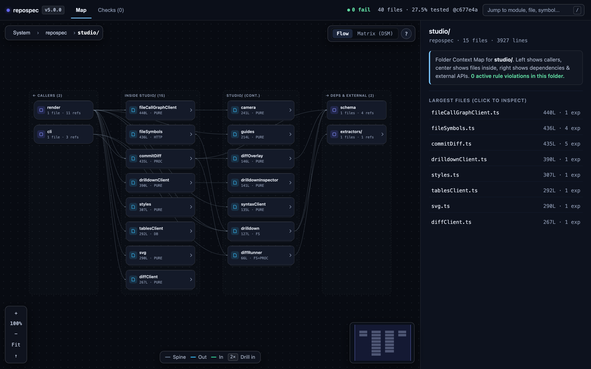
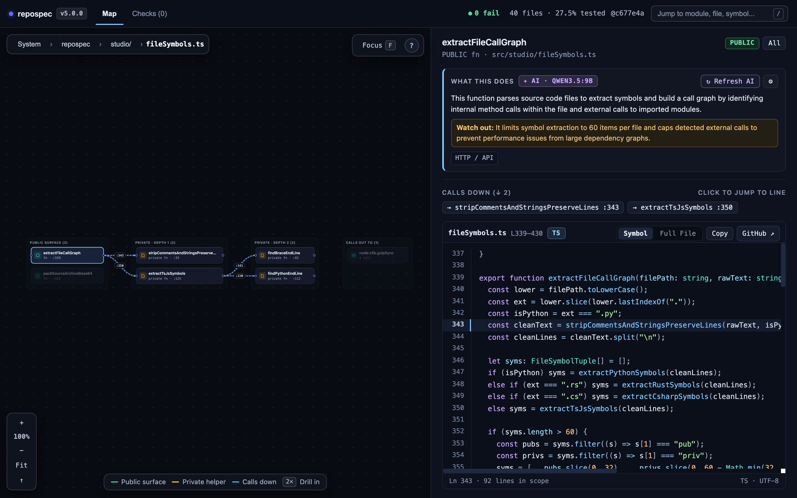
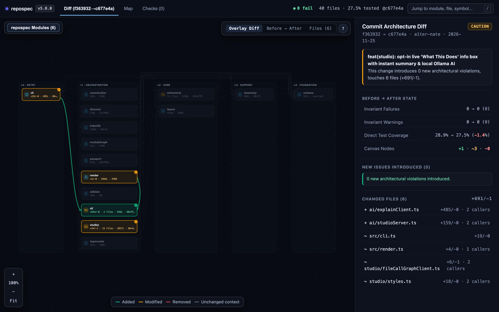

# RepoSpec

**OpenAPI for everything else in a codebase.**

RepoSpec is a deterministic, zero-AI, polyglot **architecture compiler (`v5.0.0`)** for **TypeScript, JavaScript, Rust, Python, and C# / .NET**. It compiles source code, tests, CI workflows, IaC, OpenAPI specs, SQL migrations, and governance files into one schema-validated **Index** (`repospec.sqlite` + `repospec.json`) — and derives zero-drift **Levelized Module Maps**, **"How This Module Works" Anatomy Inspectors**, SQL invariant checks, typed SDKs, and developer/agent shepherding reports on every commit.

> **Core Guarantee:** Pure commit-time static truth. Running `repospec generate` twice on the same commit produces byte-identical JSON (identical SHA-256) with zero wall-clock timestamps, zero random IDs, and zero LLM calls.

---

## Live Visual Studio (RepoSpec on RepoSpec)

Every screenshot below is RepoSpec compiling and visualizing **its own repository** (`a1ter-nate/repospec`).

### 1. Levelized Module Atlas (`L0 Entry → L4 Foundation`)
Automatic Tarjan SCC cycle detection + Kahn longest-path layering (`cli` → `orchestration` → `extractors/layout` → `taxonomy` → `schema`), Architecture Briefing drawer, Spine vs. DSM toggle, and `?` Graph Guide popovers.



### 2. Folder Context Drill-Down (`studio/`)
Double-click any folder to inspect its exact boundary: **Callers** on the left, **Files inside** in the center, and **Dependencies & External APIs** on the right.



### 3. End-Node Public/Private Symbol Callstack, Code Viewer & Opt-In Local AI
Double-click any source file to see its **Public Surface → Private Helpers (by call depth) → External Calls** callstack canvas, WCAG-AA syntax-highlighted source code, and the **"What This Does"** info box — instant deterministic analysis out of the box, plus an opt-in **`✦ Ask Local AI`** button (tested live below with local Ollama `qwen3.5:9b`, never run during `repospec generate`).



### 4. PR / Commit Architecture Diff (`Current State → New State`)
Run `repospec diff-view` on any git range to see added/modified/removed modules and edges overlaid directly on the architecture map, side-by-side `Before → After` comparison, and new invariant regressions.



---

## Why This Exists

Prose `AGENTS.md` files, hand-drawn C4 diagrams, and wiki pages silently rot the moment a refactor lands. Coding agents then guess where to put new modules, miss blast radius across CI/IaC/database cascades, and introduce subtle layer inversions or vendor leaks.

RepoSpec replaces stale architectural prose with one compiled, queryable **Index**:

| Output | Artifact | What It Solves |
| :--- | :--- | :--- |
| **Canonical IR & Schema** | `repospec.json`, `repospec.schema.json` | Strict Zod + JSON Schema contract with SHA-256 drift checks and structural PR diffs (`repospec diff`) |
| **Relational Graph DB** | `repospec.sqlite` | SQLite index of files, imports, exported symbols, IO capabilities, levelized `module_cards`, canonical layer **Axis**/**Rank**, domains, datastores, Postgres FKs, reconciled HTTP **Contracts**, env bindings, state machines, loops, and doc-path drift |
| **13 Polyglot SQL Invariants** | `rules/*.sql` | Executable architectural gates (layer inversions, datastore bypasses, vendor leaks, domain cycles, workspace cycles, untested high-fan-in modules, env drift, doc drift) projected directly onto graph nodes & edges |
| **Interactive Visual Studio** | `repospec.html` (`--inline` embed) | Adaptive **Levelized Module Atlas** (Tarjan SCC tangle detection + Kahn `L0 Entry → Ln Foundation` lanes + subsystem drill-down + 3-sentence Architecture Story), **Module Anatomy Inspector** (Public API symbols, IO capability pills, Ousterhout depth), fixed-rank layer swimlanes, 1-hop hover ego-graphs, **Design Structure Matrix (DSM)** (`M`), and Bow-Tie Focus (`F`) |
| **Slim Typed SDK** | `repospec.ids.ts`, `repospec.sdk.ts` | Closed union node IDs + typed query helpers backed directly by `bun:sqlite` |
| **Active Shepherding CLI** | `explain`, `impact`, `precedents` | Grounded file/unit **Passports**, git-range PR blast-radius briefs, and verified **Precedent** placement checks (refuses with `destination: null` when ungrounded) |

---

## 30-Second Quick Start

Requires [Bun](https://bun.sh) `>= 1.2.0`.

```bash
git clone https://github.com/a1ter-nate/repospec.git
cd repospec
bun install

# Self-verify RepoSpec (strict TS, R2 tables & PBT, R3 stateful MBT, Oxlint, Veristack gates)
bun run check

# Compile any TypeScript, JavaScript, Rust, Python, or C#/.NET repository
bun src/cli.ts generate /path/to/repo --out ./out/my-repo --mode artifact --inline

# Browse live with zero-CORS opt-in local AI explanations (Ollama / OpenAI-compatible)
bun src/cli.ts serve ./out/my-repo --port 4173

# Visual PR / Commit Architecture Diff (Current State -> New State overlay + Before/After split)
bun src/cli.ts diff-view /path/to/repo HEAD~1..HEAD --out ./out/my-repo-diff --inline
bun src/cli.ts generate /path/to/repo --diff main..HEAD --out ./out/my-repo --inline
```

### Core CLI Workflows

```bash
# File or unit Passport (layer axis/rank, blast radius, direct tests, entities, FK cascades, scoped rules)
bun src/cli.ts explain apps/api/src/client/payments.ts --db ./out/my-repo/repospec.sqlite

# PR architecture impact brief from a git diff range
bun src/cli.ts impact HEAD~5..HEAD --db ./out/my-repo/repospec.sqlite --repo /path/to/repo --format github

# Precedent & prohibition check before adding new code (refuses when ungrounded)
bun src/cli.ts precedents --path src/Domain/NewService.cs --db ./out/my-repo/repospec.sqlite

# Named or ad-hoc SQL queries against the indexed graph
bun src/cli.ts query ./out/my-repo/repospec.sqlite --named modules
bun src/cli.ts query ./out/my-repo/repospec.sqlite --named tangles
bun src/cli.ts query ./out/my-repo/repospec.sqlite --named violations
bun src/cli.ts query ./out/my-repo/repospec.sqlite --named http_endpoints
bun src/cli.ts query ./out/my-repo/repospec.sqlite --named fk_cascades

# CI drift & invariant gate (exits non-zero on failing invariants, error diagnostics, or digest drift)
bun src/cli.ts check /path/to/repo --spec ./out/my-repo/repospec.json

# Validate an existing spec or structurally diff two commits
bun src/cli.ts validate ./out/my-repo/repospec.json
bun src/cli.ts diff ./out/base/repospec.json ./out/head/repospec.json
```

---

## Architectural Design

- **Universal Levelized Module Atlas (`src/topoLevels.ts`, `src/moduleGraph.ts`):** Works on **any** codebase — single-package CLIs, Python packages, Rust crates, C# projects, or polyglot monorepos — without requiring `routes/`/`service/`/`dao/` folder names. Automatically peels single-root wrappers, detects cyclic **Tangles** via Tarjan SCC, levelizes the condensed DAG (`L0 Entry → Ln Foundation`) via Kahn longest-path ordering, and extracts per-module **Anatomy** (exported public API symbols, IO capabilities `DB`/`HTTP`/`FS`/`PROC`/`ENV`/`PURE`, Ousterhout depth, and drill-down subsystem maps).
- **First-Class Layer Axis & Rank (`src/taxonomy.ts`):** Every `code_layer` carries `{ axis: "pipeline" | "integration" | "foundation", rank }` shared identically by extractors, SQL rules, and diagram layout. Clean hexagonal flow (`Entry & Routes` → `Controllers` → `Orchestration` → `Persistence & Integration` → `Stores & External`) travels strictly left-to-right across adjacent lanes while `Shared Foundation` sits underneath.
- **Typed External Dependencies (`config/default-vendors.json`):** Separates real third-party **services** (with automatic `-js`/`-sdk`/`-client` family canonicalization) from **transport libraries** (`axios`, `node-fetch`, `reqwest`) and **observability aspects** (`Sentry`, `OpenTelemetry` badges).
- **Contract-First Surface Reconciliation (`src/indexDb.ts`):** Reconciles OpenAPI **Contracts** ahead of unmounted Express/Axum/ASP.NET sub-router fragments and attaches AST handler `file:line` provenance when matched.
- **Structure vs. Density in Diagrams (`src/layout.ts`, `src/render.ts`):** Node-link views obey a strict edge budget (**Spine** + violations at rest, 1-hop ego-graph on hover, rounded orthogonal top/bottom corridors with zero box-crossings); dense many-to-many graphs (`layers:*`, `domain_coupling`) switch seamlessly to an interactive **Design Structure Matrix (DSM)** with zero edge crossings.

---

## Portable Agent Skill

Drop [skills/repospec/](skills/repospec/) into `~/.agents/skills/repospec` or `~/.claude/skills/repospec` so coding agents orient via `repospec.sqlite` before modifying architecture or adding modules:

- [skills/repospec/SKILL.md](skills/repospec/SKILL.md) — Leading-word glossary, 4-phase operational workflow (`Index → Orient → Inspect → Verify`), and checkable exit gates
- [skills/repospec/agents/openai.yaml](skills/repospec/agents/openai.yaml) — Cross-harness model-invoked packaging metadata
- [skills/repospec/references/invariants-and-sql.md](skills/repospec/references/invariants-and-sql.md) — Authoring `rules/*.sql` invariants, SQLite views, and graph anchor columns
- [skills/repospec/references/taxonomy-and-studio.md](skills/repospec/references/taxonomy-and-studio.md) — Polyglot layer **Axis**/**Rank** model, vendor config, **Contract** reconciliation, and Studio **Spine** / **DSM** rules

---

## Verification

RepoSpec is self-verified on every commit via [Veristack](https://github.com/a1ter-nate/veristack) (`vstack`) across `R0`–`R3`:

- **R0:** `oxlint`, `oxfmt`, `vstack no-comments`, `vstack state-machines`, `lefthook.yml`, `CODEOWNERS`
- **R1:** Strict TypeScript (`tsc --noEmit`), Zod + JSON Schema validation, `.verification/control-plan.json` requirement traceability, `.verification/ratchet.json`
- **R2:** Declarative Tests-as-Data tables ([taxonomy.table.test.ts](tests/taxonomy.table.test.ts)), `fast-check` Property-Based Tests ([layout.pbt.test.ts](tests/layout.pbt.test.ts)), and deterministic skill packaging validation ([skill-packaging.test.ts](tests/skill-packaging.test.ts))
- **R3:** Stateful Model-Based Tests (`fc.commands` + `fc.modelRun`) over the SQLite index, SQL invariants, and surface reconciliation pipeline ([pipeline.mbt.test.ts](tests/pipeline.mbt.test.ts))

---

## License

MIT — see [LICENSE](LICENSE).
